# Peloton LED Dashboard
 [](https://codecov.io/gh/jc214809/Peloton-LED)

A Python dashboard for a Raspberry Pi RGB LED matrix, with a desktop browser emulator. Shows every completed workout from your latest active day, one-time personal-record celebrations, username, and lifetime workout counts by discipline.

## Setup

Quick start for local development:

```bash
git clone https://github.com/jc214809/Peloton-LED.git
cd Peloton-LED
python3 -m venv venv
source venv/bin/activate
python -m pip install -r requirements.txt
cp config.json-example config.json
# Runs in the foreground at http://localhost:8888 — Ctrl+C to stop
python peloton_led.py --emulated
```

Run commands from the project directory. The default panel is 64×64. The browser emulator is available at http://localhost:8888 while running; its settings are in `emulator_config.json`.

For every install option — the full `peloton_led.py` flag reference, getting a Peloton access token, the Raspberry Pi managed installation (`peloton-install.sh` and its flags, directory layout, automatic token renewal), upgrading, uninstalling, and troubleshooting — see the **[Installation Guide](docs/install.md)**.

## Authentication

Despite its name, `cookies.txt` contains a bearer access token, not a cookie export. See the [Installation Guide](docs/install.md#getting-a-peloton-token) for how to generate one.

An **amber padlock in the bottom-right** means the token is missing, empty, unreadable, or rejected with HTTP 401, or that the hourly renewal job found the rider needs a fresh login (for example Peloton rejected the refresh token). In that last case the current token still works for a while and data keeps updating; the padlock is the early warning. Refresh the token file and the running display automatically reloads it. It checks for file changes approximately once per second between requests. Network errors alone do not trigger the padlock.

## Refresh behavior

- Profile, overview totals, and recent history refresh in the background every **300 seconds** by default, measured after the previous successful refresh finishes.
- New data becomes visible on the next screen rotation. Authentication indicator changes can repaint the current screen.
- Performance data is held in a bounded in-memory LRU cache keyed by workout ID. Workouts less than one hour old are fetched each refresh to allow metrics to settle; changed workout metadata and missing performance data also cause a refetch.
- Rendering does not make API calls. Slow requests do not pause screen rotation.
- Each atomic snapshot includes connection state, refresh progress, last attempt/success times, refresh duration, next scheduled attempt, a sanitized error type, and a generation counter.
- Network failures preserve the previous successful snapshot in memory and retry after 15, 30, 60 seconds, etc., up to the configured interval. Rate-limit `Retry-After` values can extend that delay.
- A rejected token pauses further requests until the token file changes.
- The last successful display snapshot is saved atomically in `dashboard-cache.json` beside the token by default, with owner-only permissions. It is loaded before the first network request after a restart.
- A **blue clock in the bottom-left** appears after three consecutive refresh failures and means the board is showing saved data. The first two failures remain quiet, and any successful refresh resets the counter and clears the clock. Corrupt, incomplete, and unsupported cache files are ignored safely.

Override the interval:

```bash
python peloton_led.py --emulated --refresh-interval 300
```

## Screens and rotation

The board shows the startup logo once, then loops through the sections listed in `display.rotation`, in that order, forever. Each section is one or more screens. A section with nothing to show is skipped for that pass; for example, `streaks` is skipped while your streak is 0. Leave a section out of `rotation` to hide it.

Default order:

```json
"rotation": ["latest_workouts", "username", "streaks", "versus", "total_workouts",
             "next_milestone", "lifetime", "journey", "milestones", "goals"]
```

| Section | What it shows | Shown when | Time on screen |
|---|---|---|---|
| [`latest_workouts`](#latest_workouts--last-active-days-workouts) | Every workout from your most recent active day, then a PR celebration after a record-setting one | Always (a status screen stands in when there's no workout data) | `last_workout_detail_interval` × (1 + number of stats), plus 1 s each for the graph and zone bar, per workout |
| [`username`](#username--rider-name-and-highlights) | Your name over rotating highlights: total workouts, this week, top discipline, top 3 instructors | Always | `duration`, extended to 4 s per highlight |
| [`streaks`](#streaks--weekly-streak) | Current weekly streak and your best | Current weekly streak is above 0 | `overview_duration` |
| [`versus`](#versus--household-head-to-head) | Two riders side by side for this week | 2+ riders configured under `users` | `overview_duration` (64×32: at least 12 s) |
| [`total_workouts`](#total_workouts--lifetime-total) | Lifetime total workout count | Profile totals available | Same as `lifetime` (at least 5 s) |
| [`next_milestone`](#next_milestone--countdown-to-the-next-milestone) | Workouts left until your next milestone | A milestone is ahead of you | `overview_duration` |
| [`lifetime`](#lifetime--per-discipline-totals) | Every discipline's lifetime count, with icons | Profile totals available | `overview_duration` per page (at least 5 s) |
| [`journey`](#journey--lifetime-miles-as-a-trip) | Lifetime miles plotted as a trip between two places | Some distance has been tallied | `overview_duration` |
| [`milestones`](#milestones--milestone-celebration) | Celebration for a lifetime milestone you just reached | A milestone is reached and not yet celebrated | `overview_duration` |
| [`goals`](#goals--weekly-goals) | Progress bar toward each weekly goal | `weekly_goals.workouts` and/or `.minutes` is above 0 | `overview_duration` per goal |

Any section's time can be overridden with `screen_durations.<section>`; setting it to `0` turns the section off. The one exception is `total_workouts`: it has no key of its own and follows `screen_durations.lifetime`, so the two stay in step.

**About the screenshots.** Every image below is real data from a two-rider household, rendered by the app's own screen code. The top row is a 64×64 panel and the bottom row is 64×32. Animated screens are shown as a strip of frames, left to right, in the order they appear. Jen is the featured rider and Joel is her rival on the versus screen. Sample settings: `weekly_goals` 3 workouts / 300 minutes, `milestones` `[250, 500, 1000, 2000]`.

Data refreshes in the background (see [Refresh behavior](#refresh-behavior)), but each pass through the rotation uses one consistent snapshot. New workouts and totals appear at the start of the next pass. The login padlock is the one exception: it can appear or disappear mid-screen.

### Startup logo

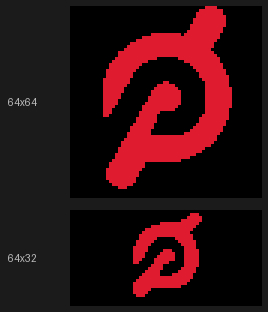

Shown once at launch for `logo_duration` seconds (default 3), never again. The app picks `prepared_logos/peloton_64x64_auto.png` or `peloton_64x32_auto.png` to match the panel, unless `logo_path` points somewhere else. A missing logo file is skipped.

### `latest_workouts` — last active day's workouts

One screen per completed workout on your **most recent active day**, newest first. That means the newest calendar date (in your timezone) with at least one completed workout. If you worked out today, you see today's workouts; if your last workout was a week ago, you see that whole day. In-progress workouts are left out.

Each screen opens with an **intro**: the discipline name in its color, class length, class title and instructor. It then shows **each stat once, one at a time**, finishing with the **output (or heart-rate) graph** and the **heart-rate zone bar** when the workout recorded them. Average heart rate and calories stay along the bottom. Each frame holds for `last_workout_detail_interval` seconds (default 4), and the graph and zone bar hold one second longer, so a cycling class with 8 stats (6 numbers, the graph and the zone bar) stays up for 38 s. On 64×32 there's no room for the instructor in the intro, so the instructor becomes the first stat instead.

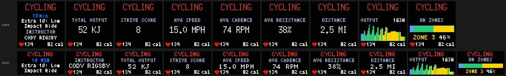

Which stats appear depends on the discipline. A stat Peloton didn't record is simply skipped.

| Discipline | Stats, in order |
|---|---|
| Cycling, Bike Bootcamp | Total output, Strive score, avg speed, avg cadence, avg resistance, distance |
| Running, Walking, Tread Bootcamp (and outdoor/hiking) | Distance, avg pace, elevation gain, avg incline |
| Rowing, Row Bootcamp | Distance, stroke rate, split per 500 m, avg output |
| Everything else (Strength, Yoga, Stretching, Meditation, Cardio, and any future discipline) | Strive score, max heart rate, distance, avg output |

Every discipline then adds the graph and zone bar if they're available.

<details>
<summary>Screenshots for every discipline</summary>

**Bike Bootcamp**
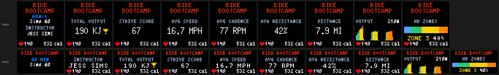

**Running**
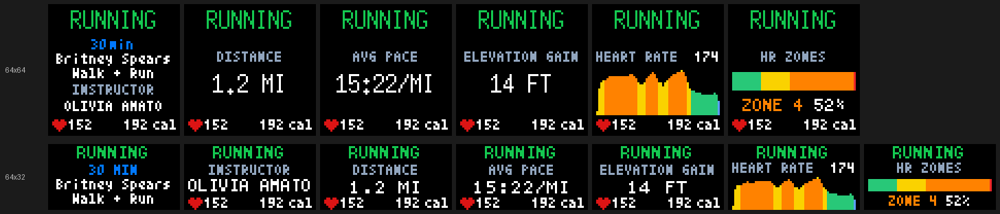

**Walking**
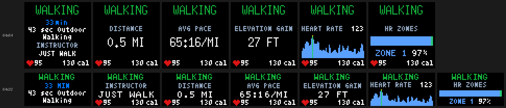

**Tread Bootcamp**
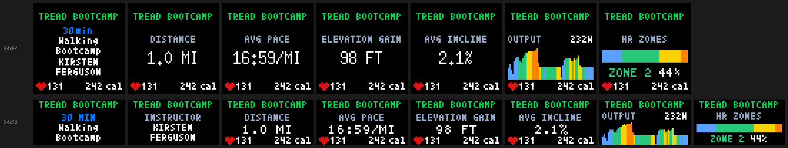

**Rowing**
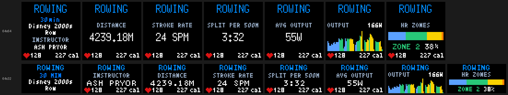

**Row Bootcamp**
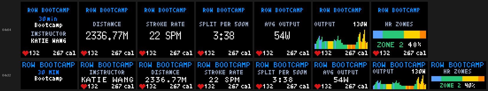

**Strength**
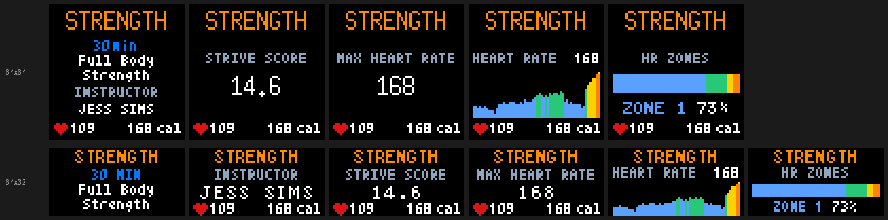

**Cardio**
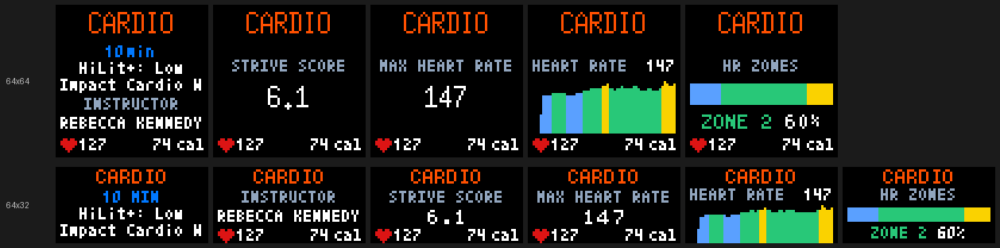

**Stretching**
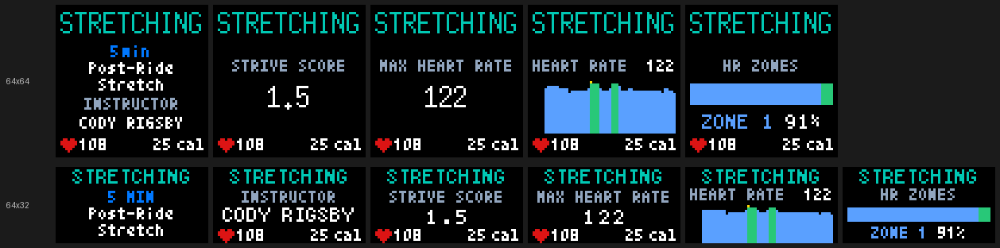

**Yoga**
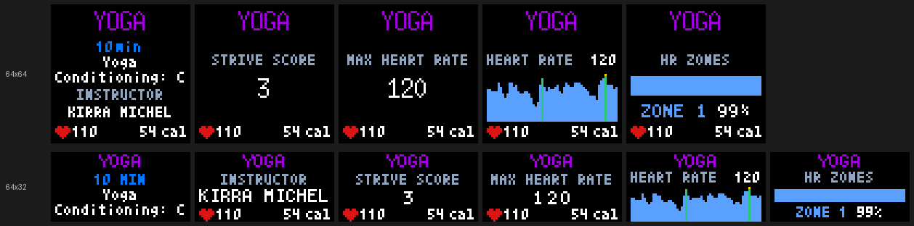

**Meditation**
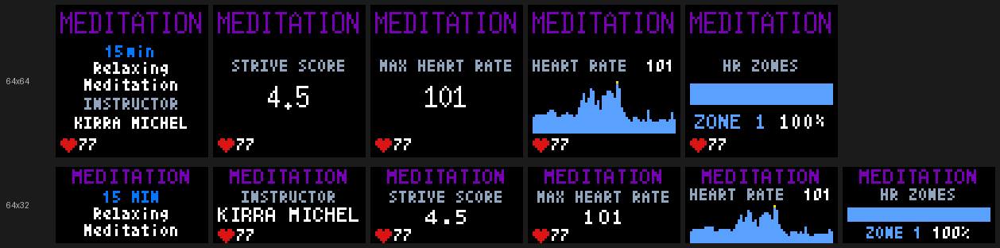

</details>

**PR celebration.** When a workout set a personal record, a gold trophy marks it in the intro and beside the record-setting value. The **first time** that PR is displayed, the workout is followed by a star-burst animation and a PR card. The card shows how much the record improved (e.g. `+14 KJ`) when the app knew the previous record; otherwise it shows the class length, as it does on a fresh install. The card lasts about 5.5 s: 1.5 s of animation plus one `last_workout_detail_interval`. Celebrated PRs are saved in the dashboard cache, so a restart doesn't replay them.

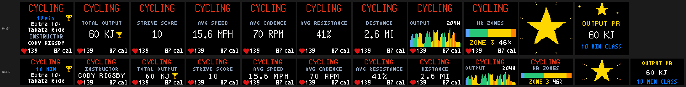

Options:

- `last_workout_detail_interval` (default `4`): seconds per intro/stat frame.
- `screen_durations.latest_workouts` / `last_workout_duration`: `0` hides the section; otherwise the value only matters with `compact_workout_pages`.
- `compact_workout_pages` (64×32 only, default `false`): use the older layout of two static pages per workout instead of rotating stats.
- `timezone`: decides which calendar day counts as "most recent".
- `history_days`, `history_limit`, `history_page_size`, `history_max_pages`: how far back to look for that day.

### `username` — rider name and highlights

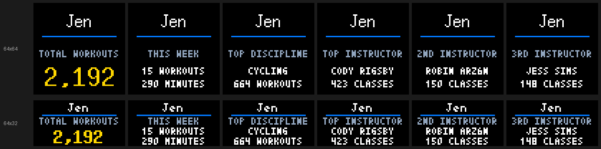

Your name stays fixed at the top in the largest font that fits, above a blue underline. The panel below rotates through up to six highlights, 4 s each: **Total Workouts** (in large gold digits), **This Week** (workouts and minutes since Monday), **Top Discipline**, and your **top three instructors** by class count. The instructor counts come from a one-time walk of your full history; after that, only new workouts are added. A workout still in progress is added once it finishes. Only real instructors count: workouts without a class (Just Walk, Just Ride, Lanebreak, ride goals, free outdoor sessions) are left out, and a class with two or more instructors counts once for each of them.

Options: `duration` (or `screen_durations.username`) is the minimum time on screen; it's extended automatically so every highlight gets its 4 s. The name comes from `--username`, then `users[].username`, then your Peloton username, then `display.username`. `font` and `color` style the name.

### `streaks` — weekly streak

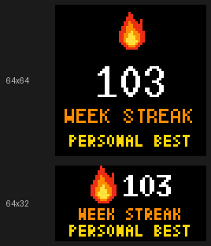

A pixel flame, your current **weekly streak**, and either `PERSONAL BEST` (when the current streak is your best) or `BEST N WEEKS`. This comes from Peloton's profile overview, so it costs no extra API calls. The screen is skipped while the streak is 0.

### `versus` — household head-to-head

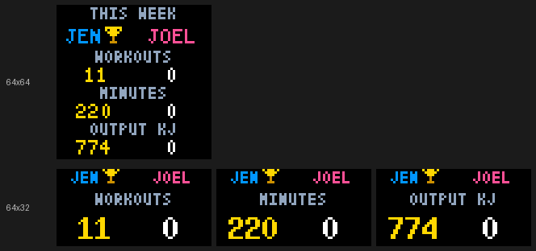

Two riders compared on **workouts, minutes and output (kJ)** for the current week, Monday to now. The rider who's ahead gets a gold trophy; ties are broken by workouts, then minutes, then output, and a full tie shows no trophy. On 64×64 all three stats fit on one page; on 64×32 they show one at a time, 4 s each.

Only shown when `users` lists two or more riders (see [Two users on one board](#two-users-on-one-board)). It appears **once per full cycle**, during the first rider's turn, and compares the first two riders.

### `total_workouts` — lifetime total

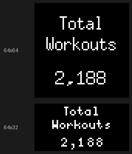

A full-size page with your lifetime workout count: the title in `color`, the number large and in gold. Its time on screen follows `screen_durations.lifetime` / `overview_duration`, with a minimum of 5 s.

### `next_milestone` — countdown to the next milestone

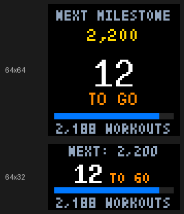

Shows how many workouts are left (`12 TO GO`) until your next lifetime milestone, with a progress bar measured from the last milestone you reached. The target is the next value in `milestones` above your total; if there isn't one, it's the next multiple of `milestone_step` (default `100`). Setting `milestone_step` to `0` with no `milestones` left ahead hides this screen.

### `lifetime` — per-discipline totals

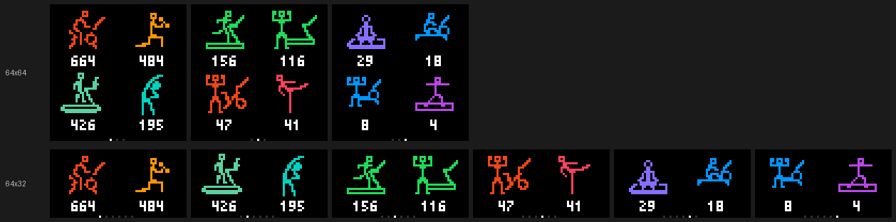

Every discipline you've done gets its own colored pixel-icon tile with its exact lifetime count, biggest first. That's four tiles per page on 64×64 and two on 64×32, with as many pages as needed. Disciplines are never merged: Bike, Tread and Row Bootcamp each keep their own tile, and their icons alternate with a strength dumbbell. All tiles on a page appear in the same frame.

Options: `screen_durations.lifetime` / `overview_duration`, per page, minimum 5 s.

### `journey` — lifetime miles as a trip

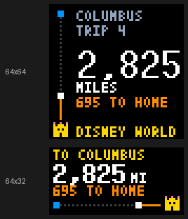

Your lifetime miles, plotted as a trip on a little map: a start dot, the route, your position, and a castle at the destination. Reaching the destination turns you around for the trip home, and so on forever. `TRIP 4` means you're on your fourth one-way leg. The screen also shows total miles and how far is left on the current leg, to a tenth of a mile (`741.6`) below 1,000 and in whole miles from there, where the decimal wouldn't fit. The route's `miles` can be a decimal too, e.g. `26.2`.

The default route is Columbus → Disney World, 880 miles, counting every workout that has a distance. Set your own:

```json
"journey": {"from": "Columbus", "to": "Disney World", "miles": 880,
            "start_date": "2026-01-01"}
```

**What counts.** Every completed workout that Peloton reports a distance for:

| Counts toward the trip | Doesn't count (no distance) |
|---|---|
| Cycling, Bike Bootcamp (bike segments) | Strength |
| Running, Outdoor Run, Tread Bootcamp (tread segments) | Yoga, Stretching, Meditation |
| Walking, Outdoor Walk | Cardio |
| Rowing, Row Bootcamp (meters converted to miles) | Any class Peloton records without a distance, and incomplete workouts |

To count only some of them, add `"disciplines"` with the names from the left column, e.g. `"disciplines": ["Cycling", "Running", "Outdoor Run"]`. Each name is matched exactly, so `"Running"` does not include Outdoor Run or Tread Bootcamp; list those too if you want them. Listing a type from the right column logs a warning, since it never adds miles. The optional `start_date` counts only miles from that day on; changing it recounts your whole history once on the next refresh. The journey can also be set per rider under `users[]`. Distances are tallied from your full history the first time, then incrementally after that, and the screen is skipped until there's at least some distance.

### `milestones` — milestone celebration

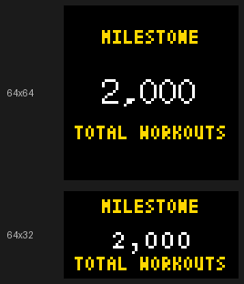

A gold `MILESTONE` card that appears **once** when your lifetime total reaches a value in `milestones` (e.g. `[100, 250, 500, 1000]`). It also appears for a multiple of `milestone_step`, but only if you crossed it within your last 10 workouts, so turning the feature on doesn't celebrate something you passed years ago. Celebrated milestones are saved in the dashboard cache. `milestones` can be set per rider under `users[]`.

### `goals` — weekly goals

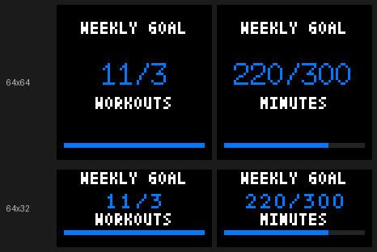

One page per weekly goal, showing current / target and a progress bar: **workouts** and/or **minutes** completed since Monday at midnight in your timezone. Turn a goal on by giving it a number above 0:

```json
"weekly_goals": {"workouts": 3, "minutes": 300}
```

`0` (the default) hides that goal. Goals can be set per rider under `users[]`.

### Status screens

When there's no workout data to show, a short status screen takes the place of the `latest_workouts` section. It stays up for the smaller of 2 s and the workout duration.

| Loading | Login needed | Offline | No workouts |
|---|---|---|---|
| 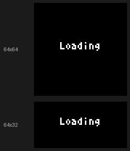 | 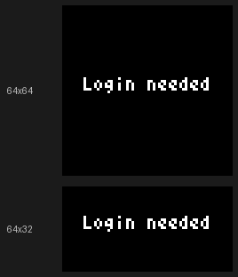 | 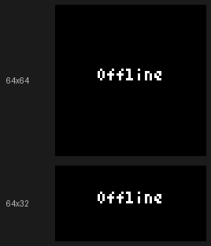 | 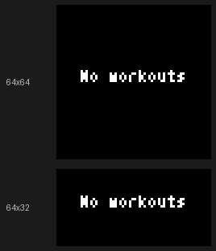 |
| Before the first successful refresh, with no saved cache | Token missing, empty or rejected; see [Authentication](#authentication) | Requests are failing and there's no saved data | Logged in, but no completed workouts within `history_days` |

### Indicators

Two small icons can appear on top of any screen:

| Login padlock (bottom-right, amber) | Stale-data clock (bottom-left, blue) |
|---|---|
| 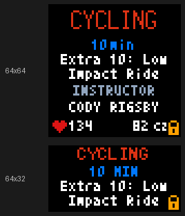 | 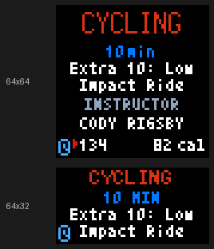 |
Peloton rejected the token or it's missing, or renewal found the rider needs a fresh login. The board keeps showing data; replace or re-seed the token and the padlock clears on the next refresh, even mid-screen. | Three refreshes in a row have failed, so you're looking at saved data. The first two failures stay quiet; any successful refresh clears it. |

## Phase 6 customization

Weekly goals are optional. Set `weekly_goals.workouts` and/or `weekly_goals.minutes` to a positive number to add progress screens; zero disables that goal. Progress counts completed workouts from Monday at midnight in the configured/profile timezone. Set `milestones` to lifetime Total Workouts thresholds such as `[100, 250, 500, 1000]`. Each reached threshold celebrates once.

Set `brightness_schedule` to `null` to retain command-line brightness, or use a day/night schedule:

```json
"brightness_schedule": {
  "day": 80,
  "night": 15,
  "day_start": "07:00",
  "night_start": "22:00"
}
```

Times use the configured/profile timezone and brightness ranges from 1 through 100. On 32-row panels, `compact_workout_pages: true` switches back to the older two-page compact workout layout in place of the rotating one.

Set `refresh_schedule` to poll Peloton less often overnight, when nobody's likely to be working out:

```json
"refresh_schedule": {
  "quiet_start": "23:00",
  "quiet_end": "05:00",
  "quiet_interval": 1800
}
```

Between `quiet_start` and `quiet_end` (wraps midnight; uses the configured/profile timezone, or `refresh_schedule.timezone` to set its own), refreshes use `quiet_interval` seconds instead of `refresh_interval`. A workout started during the window shows once normal polling resumes at `quiet_end`, not immediately. Failure backoff (after a failed request) always uses `refresh_interval`, not the quiet interval, so a real outage still retries promptly. `refresh_schedule: null` (the default) disables this and always uses `refresh_interval`.

## Offline demo and checks

Demo mode uses five synthetic API-shaped workouts, including a PR, long title, metric/imperial distances, and missing metrics. It does not read credentials or call Peloton. If no config exists, defaults are used.

```bash
python peloton_led.py --emulated --demo --cycles 1
python peloton_led.py --emulated --demo --demo-login-needed --cycles 1
python scripts/render_demo.py /tmp/peloton-demo.png
python -m pip install -r requirements-dev.txt
python -m pytest tests/ -q
python -m pytest tests/ --cov --cov-report=term-missing   # with coverage
```

GitHub Actions runs the tests with coverage on Python 3.11 and 3.13 for every pull request and push to `main`, and uploads the report to [Codecov](https://codecov.io/gh/jc214809/Peloton-LED) (the badges at the top).

`--cycles 1` stops after one full rotation. Omit it to run continuously. Durations come from configuration; `--display-duration` overrides only the username screen. The PNG preview uses the same emulator text drawing and screen code, without starting a browser server.

## Configuration

Settings live under `display` in `config.json`. Invalid values produce a startup error before hardware or network initialization. Every setting below is optional — an absent key falls back to its default, so a minimal `{"display": {}}` (or even `{}`) is a valid config.

| Setting | Default | Meaning |
|---|---|---|
| `username` | Peloton Member | Fallback if profile is unavailable; `--username` takes precedence |
| `font` | stats | Username font: discipline, info, titles, stats, countdown |
| `color` | white | white, red, gold, disney_blue, down |
| `duration` | 4 | Username screen seconds |
| `overview_duration` | 4 | Per-discipline and PR screen seconds |
| `last_workout_duration` | 30 | `0` hides workout screens; otherwise only used with `compact_workout_pages`. Normal workout pages are timed by `last_workout_detail_interval` (see below) |
| `last_workout_detail_interval` | 4 | Seconds each stat (and the intro) holds for during the workout screen's rotation; the graph and zone bar get one second more |
| `logo_duration` | 3 | Startup logo seconds |
| `logo_path` | Auto-selected | Optional logo file; missing logos are skipped |
| `timezone` | Profile, then system local | Calendar-day grouping; explicit config must be a valid IANA zone |
| `refresh_interval` | 300 | Positive integer seconds |
| `history_days` | 90 | History lookback |
| `history_limit` | 200 | Maximum recent workouts returned |
| `history_page_size` | 50 | Workouts requested per API page |
| `history_max_pages` | 10 | Page safety limit |
| `instructor_tally_max_pages` | 200 | Page safety limit for the one-time full-history instructor tally |
| `performance_cache_size` | 32 | Maximum in-memory performance records |
| `cache_path` | Beside token | Optional persistent snapshot and PR-state file |
| `rotation` | See below | Screen sections to show, and their order |
| `screen_durations` | `{}` | Per-section seconds, overriding the individual duration settings above |
| `weekly_goals` | `{"workouts": 0, "minutes": 0}` | Weekly workout/minute targets; `0` disables that goal. See [Phase 6 customization](#phase-6-customization) |
| `milestones` | `[]` | Lifetime Total Workouts thresholds that celebrate once each, e.g. `[100, 250, 500]` |
| `milestone_step` | `100` | Also count down to (and celebrate) every Nth lifetime workout, e.g. 2,200 after 2,100; `0` turns this off |
| `journey` | Columbus → Disney World, 880 mi, every workout with a distance | Lifetime miles shown as a trip: `{"from": "Columbus", "to": "Disney World", "miles": 880}`. Any places and distance; optional `"disciplines"` list narrows which workouts count (see [`journey`](#journey--lifetime-miles-as-a-trip)); also settable per rider under `users[]`. Optional `"start_date": "YYYY-MM-DD"` counts only miles from that day on (display timezone); changing it recounts the full history once on the next refresh |
| `brightness_schedule` | `null` | Optional day/night brightness schedule. See [Phase 6 customization](#phase-6-customization) |
| `refresh_schedule` | `null` | Optional overnight quiet-hours polling schedule. See [Phase 6 customization](#phase-6-customization) |
| `compact_workout_pages` | `false` | On 32-row panels, use the older two-page compact workout layout instead of the rotating one |

`rotation` accepts any subset of `latest_workouts`, `username`, `streaks`, `versus`, `total_workouts`, `next_milestone`, `lifetime`, `journey`, `milestones`, `goals`, each at most once. See [Screens and rotation](#screens-and-rotation) for what each one shows. `screen_durations` keys are `latest_workouts`, `username`, `streaks`, `versus`, `next_milestone`, `lifetime`, `journey`, `milestones`, `goals` — `lifetime` controls both Total Workouts and lifetime discipline pages so their timing stays synchronized.

Each full-board workout screen shows a discipline/duration/title intro, then shows each of that discipline's stats once, one at a time, each held for `last_workout_detail_interval` seconds, with one extra second for the graph and the zone bar. The page lasts exactly that long (`last_workout_detail_interval * (1 + stat count)`, plus 1 s per graph or zone bar), so every stat gets one full turn with no cut-offs and no repeats. A workout with no stats shows its intro for one interval. `last_workout_duration` (or `screen_durations.latest_workouts`) only sets the page length with `compact_workout_pages` on 32-row panels, where pages are static; `0` still disables the section.

Legacy `ride` and `park` font names map to `discipline`. `per_workout_duration` is accepted for older configs but is not used in the current rotation.

History fetches stop on the date cutoff, end of results, repeated pages, or configured limits. A warning is logged when a limit prevents a complete search. Explicit incomplete workouts are excluded; older payloads without a status remain usable. If no workout matches the selected discipline, the latest completed workout is shown and the fallback is logged.

Timestamps accept Unix seconds/milliseconds and ISO dates with offsets. Date-only values can be grouped into days but never establish which workout occurred last. Explicit API metrics take precedence over derived averages, including rowing split values supplied in minutes per 500 m. Missing metrics remain blank; zero is preserved. Output PRs and splits PRs share a badge, but only output PRs receive the output star.

Each refresh saves Peloton's output personal-records table (one record per discipline and class length) in the dashboard cache, at no extra API cost since it arrives with the profile overview. Peloton only reports the current record, so when a record's workout ID changes, the saved value is kept as the record it replaced, and the PR screen shows the gain (e.g. `+14 KJ`). A PR set before the app first saw the old record, such as on a fresh install, shows the class length instead.

### Full example: every option set explicitly

[`config.json-example`](config.json-example) and [`config.dual-users-example.json`](config.dual-users-example.json) are intentionally minimal — anything left out just uses its default. The example below sets every `display` option and every per-user option at once, purely as a reference for what exists; it isn't meant to be used verbatim or copied as a starting point.

```json
{
  "debug": false,
  "users": [
    {
      "name": "Joel",
      "email_env": "PELOTON_EMAIL_RIDER_ONE",
      "password_env": "PELOTON_PASSWORD_RIDER_ONE",
      "token_path": "cookies-joel.txt",
      "cache_path": "dashboard-cache-joel.json",
      "username": "Joel",
      "weekly_goals": { "workouts": 5, "minutes": 0 },
      "milestones": [100, 250, 500]
    }
  ],
  "display": {
    "font": "stats",
    "color": "white",
    "duration": 9,
    "overview_duration": 4,
    "last_workout_duration": 15,
    "last_workout_detail_interval": 4,
    "logo_duration": 3,
    "logo_path": null,
    "timezone": "America/New_York",
    "refresh_interval": 300,
    "history_days": 90,
    "history_limit": 200,
    "history_page_size": 50,
    "history_max_pages": 10,
    "instructor_tally_max_pages": 200,
    "performance_cache_size": 32,
    "rotation": ["username", "latest_workouts", "total_workouts", "lifetime", "milestones", "goals"],
    "screen_durations": { "latest_workouts": 15, "username": 9, "lifetime": 5, "milestones": 4, "goals": 4 },
    "brightness_schedule": null,
    "refresh_schedule": null,
    "compact_workout_pages": false
  }
}
```

Top-level and per-user fields, and whether each is required:

| Field | Required? | Notes |
|---|---|---|
| `debug` | No (default `false`) | Verbose logging |
| `users` | No | Omit entirely for single-user mode (`config.json-example`); see [dual-user guide](docs/dual-users.md) |
| `users[].name` | **Yes**, once `users` is present | Must be unique (case-insensitive) across all users |
| `users[].token_path` | No | Defaults to `cookies-<slug of name>.txt` beside the config file |
| `users[].cache_path` | No | Defaults to `<token file stem>-dashboard-cache.json` |
| `users[].username` | No | Defaults to the account's real Peloton username |
| `users[].email_env` | No | Only used for unattended token renewal (`refresh_cookies.py --ensure`) |
| `users[].password_env` | No | Only used for unattended token renewal |
| `users[].weekly_goals` | No | Falls back to `display.weekly_goals` when omitted |
| `users[].milestones` | No | Falls back to `display.milestones` when omitted |
| `matrix` | No | LED panel/driver settings, e.g. `{"rows": 32, "gpio_mapping": "adafruit-hat"}`; one key per `--led-*` flag, see the [Installation Guide](docs/install.md#every-peloton_ledpy-command-line-flag). Defaults to a 64×64 panel |
| `display` | No | Omit entirely to use every default in the table above |
| every `display.*` key | No | See the configuration table above for each default |

## Display support and remaining work

Both **64×64** and **64×32** panels are supported; for 64×32 set `"matrix": {"rows": 32}` in `config.json` (or pass `--led-rows 32`). Panels can't report their size, so it has to be set. On 64×32 the workout screen uses the same intro-then-rotating-stats layout as 64×64, adapted to fit: the instructor is the first rotating stat, and the heart-rate/calories bar shows during the stats. See [docs/64x32-NOTES.md](docs/64x32-NOTES.md) for every difference. Preview either size with `python scripts/render_rotation.py --height 32 --demo`.

Live mode cycles through every completed workout on the latest active day. Every discipline uses a safe common layout; cycling/bike bootcamp, running/walking/tread, and rowing/row bootcamp add discipline-specific statistics when Peloton supplies them. Unknown future disciplines still show discipline, title, duration, heart rate, calories, and compatible common metrics. Lifetime totals preserve every discipline and its exact count in separate pixel-icon tiles, four per page on 64×64 and two per page on 64×32. No disciplines are combined. Goals, milestones, scheduled brightness, configurable rotation, and optional two-page 32-row workout details are implemented in Phase 6.

## Code map

- `peloton_led.py`: startup and screen rotation
- `peloton/dashboard.py`, `peloton/cache.py`: background refresh, token reload, snapshots, and recovery
- `peloton/api.py`: authenticated requests and bounded history pagination
- `peloton/timestamps.py`, `selection.py`, `records.py`, `totals.py`: shared data and lifetime pagination rules
- `peloton/summaries.py`: metric normalization for screens and reports
- `display/ui/`: screens and login indicator
- `driver/`: hardware/emulator selection
- `scripts/refresh_cookies.py`: browser login, refresh-token renewal, board seeding, and verified token saving
- `scripts/render_demo.py`: reproducible screen preview

## Phase 3 validation

See [Phase 3 implementation status and evidence](docs/phase-3-status.md).

## Phase 4 validation

See [Phase 4 recovery and durable-event status](docs/phase-4-status.md).

## Phase 1–2 validation

See [implementation status and validation evidence](docs/phase-1-2-status.md).

## Raspberry Pi managed installation

`sudo ./peloton-install.sh` installs Peloton LED as a managed systemd service under a dedicated, unprivileged account, and is also how you upgrade an existing install. See the **[Installation Guide](docs/install.md#raspberry-pi-managed-install)** for the full walkthrough: directory layout, every installer flag, automatic token renewal (`--auto-token`), upgrading, uninstalling, and diagnostic commands.

On the Pi, edit `config.json` in the checkout and restart the service; the services read it directly. See [Editing the config](docs/install.md#editing-the-config).

## Two users on one board

See the complete [dual-user setup and operations guide](docs/dual-users.md).

Copy `config.dual-users-example.json` to a private configuration file and list riders in the desired display order. Each rider requires a unique `token_path` and `cache_path`. The board completes the first rider's full rotation before starting the second rider's rotation. Profile data, latest workouts, totals, weekly goals, milestones, PR acknowledgements, login state, stale state, and disk cache remain isolated per rider.

Relative token and cache paths resolve beside the configuration file. For a local setup, create each token separately:

```bash
python scripts/refresh_cookies.py --cookies cookies-rider-one.txt
python scripts/refresh_cookies.py --cookies cookies-rider-two.txt
```

Each command prompts for that rider's Peloton email and password without placing the password in shell history.

Token files contain bearer credentials and must stay out of Git. The included `cookies*.txt` ignore rule covers the recommended names.

For unattended Pi renewal, each user entry names its email/password environment variables. The resulting root-owned `/etc/peloton-led/auth.env` looks like this:

```bash
PELOTON_EMAIL_RIDER_ONE="first@example.com"
PELOTON_PASSWORD_RIDER_ONE="first password"
PELOTON_EMAIL_RIDER_TWO="second@example.com"
PELOTON_PASSWORD_RIDER_TWO="second password"
```

`peloton-token-refresh.timer` checks every configured token hourly and renews each one when fewer than 12 hours remain, using its saved refresh token (no browser) when it has one. One user's failed login does not mix or overwrite another user's token. The installer stores each token and cache under `/var/lib/peloton-led/` with restricted permissions.

If Peloton rejects a saved refresh token (`invalid_grant`, e.g. after a password change), a board that has Chromium and the rider's credentials tries one browser login and then waits a day before trying again, so a slow board never fails the same login every hour. A board installed with `--no-browser` keeps its current token until you [seed it again](docs/install.md#seeding-a-board-from-another-computer---no-browser).

Each refresh token belongs to a *chain* that starts at a login and continues through every renewal. The status command shows how old each rider's chain is and how many renewals it has had (`refresh chain 12.3 days old, 140 renewals`). When Peloton ends a chain (`invalid_grant`), the renewal log records its age:

```bash
sudo -u peloton-led /opt/peloton-led/venv/bin/python /opt/peloton-led/scripts/refresh_cookies.py \
    --status --all-users --config /etc/peloton-led/config.json --cookies /var/lib/peloton-led/cookies.txt
```

To get a Pushover alert when renewal stops working, add your Pushover application token and user key to the same `auth.env`. No restart is needed; the timer reads the file on every run. `peloton-install.sh --reconfigure` rewrites `auth.env`, so add them again after reconfiguring.

```bash
PUSHOVER_APP_TOKEN="your application token"
PUSHOVER_USER_KEY="your user key"
```

An alert goes out after two failed hourly runs in a row (one Wi-Fi blip stays quiet), or at once when Peloton rejects the refresh token (`invalid_grant`), since that only heals by re-seeding the board. While the failure lasts it repeats at most once a day, and the first good run afterwards sends one "recovered" notice. Each message starts with the board's hostname. Without these keys the timer just logs failures to the journal.

## Phase 5 validation

See [Phase 5 managed-installation status](docs/phase-5-status.md). Native matrix access, Pi Chromium login, and boot/restart behavior still require one on-device acceptance run because the development host is macOS.

## Phase 6 validation

See [Phase 6 customization status](docs/phase-6-status.md).
